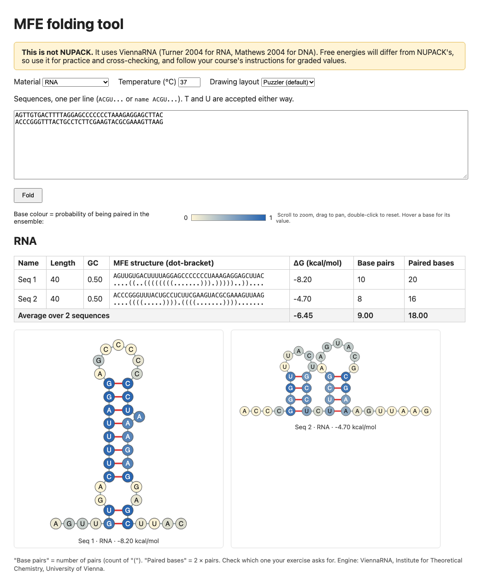

# MFE folding tool

A small web app for practising nucleic acid secondary-structure prediction
(minimum free energy, MFE) for DNA and RNA, e.g. for exercises like
"fold 5 random 40-mers as DNA and RNA and compare free energy and paired bases".

Single-strand MFE folding with [ViennaRNA](https://www.tbi.univie.ac.at/RNA/)
(Turner 2004 parameters for RNA, Mathews 2004 for DNA). Free energies can differ
from NUPACK's; this tool has not been compared against NUPACK output.

**Live demo:** <https://mfe-folding-tool.onrender.com> (Render free instance: it
sleeps after 15 minutes without traffic; Render's documentation says waking it takes
about a minute (one wake-up measured here: about 13 s). Open it a little before you need it).



## Features

- Several sequences at once (one per line, optionally `name SEQUENCE`); DNA, RNA or both.
- Temperature setting (default 37 °C, range -10 to 100).
- MFE structure (dot-bracket), ΔG in kcal/mol, number of base pairs, number of
  paired bases (2 x pairs), and averages over all sequences.
- Structure drawings with three layouts (Puzzler, Circular, NAView), bases
  coloured by their probability of being paired in the thermodynamic ensemble,
  scroll to zoom, drag to pan, double-click to reset.

## Run

Tested with Python 3.10 (local) and 3.11 (Docker image).

```bash
python3 -m venv .venv
.venv/bin/python -m pip install -r requirements.txt
.venv/bin/python app.py
```

Then open <http://127.0.0.1:5050>. (Port 5050 is used because macOS AirPlay
Receiver often occupies 5000.)

## Test

```bash
.venv/bin/python test_app.py
```

The tests check the code runs consistently (parsing, T/U handling, layouts,
probability ranges). They do not validate the energy values against NUPACK.

## Run in Docker / hosting

A `Dockerfile` is included (gunicorn, non-root user, request limits lowered to
20 sequences of up to 200 nt via `MFE_MAX_SEQS` / `MFE_MAX_LEN`). It listens on
`$PORT`, defaulting to 7860.

```bash
docker build -t mfe-tool .
docker run --rm -p 7860:7860 mfe-tool      # then open http://127.0.0.1:7860
```

Built and run locally on an Intel Mac (linux/amd64) and checked against the
non-Docker run.

`render.yaml` is a Render Blueprint (Docker runtime, free plan, Frankfurt):
in the Render dashboard choose *New > Blueprint* and select this repository.
This is how the live demo above is deployed; the free plan accepted the Docker
runtime.
Notes from the providers' documentation (read 2026-11-04, not tested):

- Hugging Face: Docker Spaces need a paid plan to create (PRO for personal
  accounts); free Spaces go to sleep when unused.
- Render: free web services spin down after 15 minutes without traffic and take
  about a minute to wake up.

## Limits

- Single strands only, no multi-strand complexes or concentrations.
- Local default is up to 50 sequences of up to 500 nt per request. Measured on
  an Intel i7 laptop: one 300 nt sequence takes about 0.4 s and one 500 nt
  sequence about 1.5-2 s (RNA, including the drawing). "Both" doubles the work.
  On the Render free instance one 300 nt sequence with "Both" took about 5 s
  (measured once), several times slower than the laptop, so the hosted limit is
  200 nt.
- Request bodies over 200 KB are rejected.
- `python app.py` uses Flask's development server on localhost only. For anything
  public use the Docker image (gunicorn). There is no rate limiting or
  authentication.

## Credit and licence

Folding and the partition function are computed with ViennaRNA, Institute for
Theoretical Chemistry, University of Vienna. If you use results in a publication,
cite: Lorenz R, Bernhart SH, Höner zu Siederdissen C, Tafer H, Flamm C, Stadler PF,
Hofacker IL. ViennaRNA Package 2.0. Algorithms for Molecular Biology 6:26 (2011). ViennaRNA's licence allows
research, educational and commercial use without a fee, provided credit is
given; putting it into a commercial product requires contacting its authors.
See the ViennaRNA package for the full text.

The code in this repository is released under the MIT licence (see `LICENSE`).
ViennaRNA is a separate dependency with its own licence.
